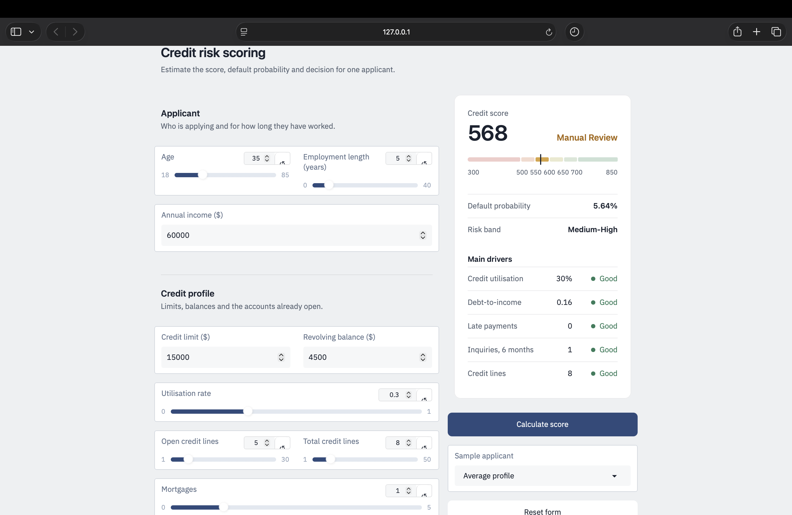

<div align="center">

# Credit Risk Intelligence System

**An end-to-end machine learning pipeline that predicts loan default, turns it into a 300-850 credit score, explains every decision, and serves it through an interactive dashboard.**




</div>

---

## Overview

Lenders lose money on borrowers who default, and regulators expect every decision to be explainable. This project covers the full workflow in a single notebook:

1. Predict the probability of default for each applicant.
2. Convert it into an interpretable 300-850 score with risk bands and a decision.
3. Explain each prediction with SHAP.
4. Monitor drift over time with the Population Stability Index (PSI).
5. Serve the model through a Gradio dashboard.

The data is synthetic, generated inside the notebook with distributions modelled on credit-bureau variables, so the project runs end to end with no downloads.

## Results

Evaluated on a held-out test set of 10,000 applicants (20% stratified split).

| Model | ROC-AUC | Recall | Precision | F1 |
|---|---|---|---|---|
| **Logistic Regression** | **0.8394** | 0.8171 | 0.3198 | 0.4597 |
| XGBoost (Optuna-tuned) | 0.8372 | 0.8034 | 0.3224 | 0.4601 |
| LightGBM | 0.8324 | 0.7930 | 0.3315 | 0.4676 |
| Random Forest | 0.8299 | 0.8288 | 0.2950 | 0.4351 |

Recall, precision and F1 use the cost-based threshold of 0.118 described below. Logistic Regression has the best AUC and is the model behind the dashboard.

**Success criteria** (defined before modelling):

| Metric | Target | Result |
|---|---|---|
| ROC-AUC | > 0.80 | 0.8394 |
| Recall (default) | > 0.70 | 0.8171 |
| KS statistic | > 0.40 | 0.5204 |
| Gini coefficient | > 0.60 | 0.6788 |

**Scorecard bands** (test set):

| Band | Score | Share of applicants | Default rate | Decision |
|---|---|---|---|---|
| Very High Risk | below 500 | 10.4% | 61.3% | Decline |
| High Risk | 500-549 | 32.1% | 20.4% | Decline |
| Medium-High | 550-599 | 40.5% | 5.6% | Manual review |
| Medium | 600-649 | 14.3% | 1.3% | Conditional approve |
| Low Risk | 650-699 | 2.3% | 0.9% | Approve |
| Very Low Risk | 700 and above | 0.4% | 0.0% | Approve |

Default rate falls steadily as the score rises, which is what a scorecard should do.

**Business impact.** With a missed default costing $15,000 and a rejected good applicant costing $2,000, approving everyone would cost $23.0M on the test set. The Logistic Regression model brings that to $9.6M, a net saving of about $13.5M. These figures come from synthetic data and show the method, not real-world performance.

## Pipeline

| Stage | What it does |
|---|---|
| Data | Generates 50,000 synthetic applicants with realistic missing values |
| EDA | Target balance, distributions, categorical effects, correlations |
| Feature engineering | Payment-behaviour features, financial-health ratios, inquiry intensity |
| Feature screening | Weight of Evidence and Information Value (IV) ranking |
| Preprocessing | Train/test split first, then median imputation and scaling fitted on train only |
| Models | Logistic Regression, Random Forest, XGBoost with Optuna tuning, LightGBM |
| Evaluation | ROC and precision-recall curves, confusion matrices, cost-benefit analysis |
| Explainability | SHAP global importance, beeswarm, and per-applicant explanations |
| Scorecard | Points-based score (base 600, 50:1 odds, 20 points to double the odds), KS and Gini |
| Monitoring | PSI on the score and on every feature, with alert thresholds |
| Deployment | Gradio dashboard for scoring a single applicant |

## Design decisions

- **Cost-based threshold, not 0.5.** For a calibrated model, rejecting when P(default) exceeds `C_FP / (C_FP + C_FN) = 2000 / 17000 = 0.118` minimises expected cost.
- **No resampling.** SMOTE and similar methods distort predicted probabilities, and both the scorecard and the threshold depend on them being calibrated.
- **No data leakage.** The split happens before the imputer and scaler are fitted, so no test-set information reaches training.
- **Explainable by default.** SHAP contributions can be turned into adverse-action reason codes.

## Dashboard

The Gradio dashboard takes 15 applicant inputs grouped into four sections and returns:

- the credit score and decision (approve, conditional approve, manual review, decline)
- a ruler showing where the score sits across the six scorecard bands
- the default probability and risk band
- the main risk drivers: utilisation, debt-to-income, late payments, inquiries and credit lines

Features that are not collected in the form (education, marital status, home ownership, dependents) are set to the training median.

## Getting started

```bash
git clone https://github.com/raghuvendra34/Credit-Risk-Intelligence-System.git
cd Credit-Risk-Intelligence-System

python -m venv .venv
source .venv/bin/activate        # Windows: .venv\Scripts\activate
pip install -r requirements.txt
```

Open `Credit_Risk_Intelligence_System.ipynb` in VS Code or Jupyter, select the `.venv` kernel, and run all cells from top to bottom. The last code cell launches the dashboard at `http://127.0.0.1:7860`.

Run the cells in order. The dashboard cell reads the trained model, the scaler and the scorecard from the cells above it.

## Project structure

```
Credit-Risk-Intelligence-System/
├── Credit_Risk_Intelligence_System.ipynb   # full pipeline, EDA to dashboard
├── requirements.txt
├── assets/
│   └── dashboard.png
└── README.md
```

## Limitations

- The data is synthetic, so absolute metrics are optimistic and not comparable to real bureau data. The pipeline is the deliverable, not the numbers.
- Splits are random. Real credit models should be validated out-of-time.
- No fairness audit has been done, which is required before any real lending use.

## Future work

- Benchmark on a real dataset such as Give Me Some Credit or Home Credit
- WoE-binned logistic regression as a regulatory-style scorecard
- Probability calibration and champion-challenger testing
- FastAPI service for the model, and MLflow experiment tracking
- Fairness-aware modelling and reporting

## Author

**Raghuvendra** - B.Tech in Artificial Intelligence and Machine Learning, VIT Bhopal

Portfolio: [raghuvendra34.github.io](https://raghuvendra34.github.io) | GitHub: [@raghuvendra34](https://github.com/raghuvendra34)

## License

Released under the MIT License.
